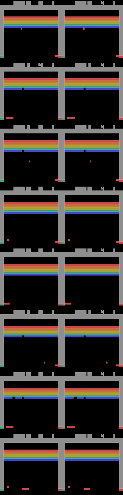
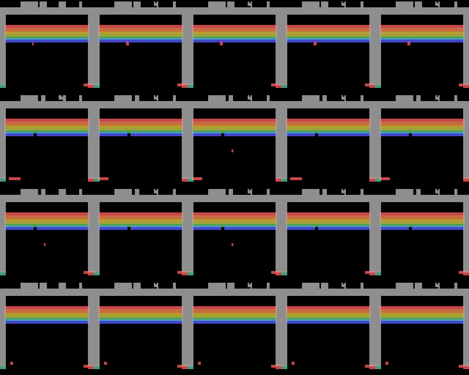

# Atari world model + inverse dynamics

A small, end-to-end version of the recipe behind action-conditioned world models, trained on Atari Breakout:

1. **Collect** gameplay as `(frame, action)` pairs.
2. **Inverse dynamics model (IDM):** infer the action a player took from the frames around it, so unlabelled video can be turned into training data (the VPT idea).
3. **Tokenizer:** a VQ-VAE that turns each 64×64 frame into 8×8 discrete tokens.
4. **World model:** a causal transformer over frame tokens interleaved with action tokens. Given a few real frames and a sequence of actions, it imagines the future frame by frame.
5. **Evaluate** with numbers rather than only nice GIFs (see below).

```
gym env ──► (frame, action) dataset ──┬──► IDM: frames → action ──► relabel data (actions_idm)
                                      └──► VQ-VAE tokens ──► transformer world model ◄── actions (true or IDM)
                                                                    │
                     eval: PSNR vs copy-last-frame baseline, IDM-on-imagined-video consistency, counterfactual GIFs
```

## Results

One run of `colab.ipynb` with its defaults on a single T4: 500 random-policy episodes, held-out episodes for every number below. Raw outputs are in [`results/`](results/).

Each world model gets 4 real frames as context, then imagines 12 frames on its own; numbers are over 64 held-out windows.

| | true action labels | IDM pseudo-labels |
|---|---|---|
| IDM accuracy on held-out episodes (chance 25%) | 65.9% | (same IDM) |
| Tokenizer reconstruction PSNR (ceiling for the world model) | 31.1 dB | 31.1 dB |
| World model PSNR, mean over 12 imagined steps | 30.9 dB | 30.4 dB |
| World model PSNR, imagined step 1 → step 12 | 30.8 → 30.7 dB | 30.9 → 29.8 dB |
| Copy-last-frame baseline PSNR, step 1 → step 12 | 42.7 → 31.6 dB | 42.7 → 31.6 dB |
| Foreground PSNR: world model / copy-last-frame / tokenizer ceiling | 10.1 / 8.9 / 10.4 dB | 9.7 / 8.9 / 10.4 dB |
| Action consistency: IDM on imagined video vs on real video | 65.6% vs 67.0% | 70.2% vs 67.0% |

**What the numbers say**

- **The world model gets within 0.3 dB of its ceiling, and its error does not grow over 12 steps** with true labels (30.8 → 30.7 dB). On whole-frame PSNR it does not beat copying the last frame (30.9 vs 35.9 dB): the background is static, so copying it is almost free, while any frame decoded from tokens is capped at the tokenizer's 31.1 dB. That ceiling, not the dynamics, limits the whole-frame score; a better tokenizer is the next lever.
- **On the pixels that move, it beats the baseline** (10.1 vs 8.9 dB foreground PSNR), close to the tokenizer ceiling of 10.4 dB.
- **It follows its actions.** The IDM recovers the conditioning actions from imagined video almost as well as from real video (65.6% vs 67.0%).
- **IDM pseudo-labels cost accuracy over the horizon.** The pseudo-label model starts level with the true-label one but drifts to 29.8 dB by step 12. Its action consistency (70.2%) is higher than on real video; that is expected, not good news, since the model learned the IDM's own reading of the actions. This metric flatters a model trained on the same IDM.
- **The IDM's errors are the game's ambiguity.** LEFT and RIGHT are recovered 82% and 88% of the time. NOOP (34%) and FIRE (57%) are the hard ones: FIRE does nothing while a ball is in play, and LEFT or RIGHT does nothing when the paddle is already against that wall, so all of these can produce the same frames as NOOP.

**Imagined rollouts** (left: real future, right: imagined from the same 4 frames and the same actions)



**Counterfactuals** (columns: real, then NOOP, FIRE, RIGHT, LEFT held for all 12 steps from the same start). Holding LEFT drives the paddle to the left wall and RIGHT to the right wall. In the bottom row the ball has just been lost: only the FIRE column serves a new ball, as in the real game.



## How the evaluation works

- **PSNR against two references.** Copying the last real frame is the baseline a world model has to beat. Decoding the ground-truth tokens is the ceiling a token-based model can reach. Scores are reported per imagined step, so error accumulation over the horizon is visible.
- **Foreground PSNR.** Whole-frame PSNR is dominated by the static background, so a model that drops every moving object still scores well on it. Foreground PSNR is measured only on pixels that differ from the static background (the ball, paddle and broken bricks), which is where the dynamics are.
- **Action consistency.** The IDM reads the imagined video and we check whether it recovers the actions the world model was conditioned on, compared with the IDM on real video. A model that ignores its actions can still look plausible; this metric catches that.
- **Counterfactuals.** From the same real start, each column holds one action down for the whole rollout (`*_counterfactual.gif`). LEFT and RIGHT should move the paddle in opposite directions.
- **Pseudo-label experiment.** The world model is trained twice: once on true actions and once on IDM-inferred actions. The gap shows how much a world model loses when its labels come from an IDM instead of the game, which is the question that matters when the training data is unlabelled video.

## Design notes

- **Sticky actions off** (`repeat_action_probability=0`). With the ALE default of 0.25, the logged action is sometimes not the one executed, which would put label noise into both models.
- **Max-pool downscaling.** Area-averaging 210×160 → 64×64 turns the ball into one dim pixel that a reconstruction loss ignores. Max-pooling keeps it bright.
- **Foreground-weighted tokenizer loss.** A first run with plain L1 reached 28 dB PSNR while using 15 of 512 codes and drawing no ball or paddle at all: those objects cover under 1% of the pixels. The loss now weights pixels that differ from the static background (the median frame) 50× more.
- **Random policy with held actions** (1–8 steps), so the data has sustained paddle movement rather than jitter.
- **Ambiguous actions are expected.** In Breakout, FIRE only matters when no ball is in play, so FIRE and NOOP usually produce identical frames, and LEFT at the left wall equals NOOP. The IDM confusion matrix (`runs/idm_eval.json`) shows this; it is a property of the game, not an IDM bug.
- **Cosine-similarity VQ codebook** (unit-norm codes and latents) to keep codebook usage high without extra tricks.

## Run

On Colab or Kaggle with a GPU, open `colab.ipynb`. Locally:

```bash
pip install -e ".[dev]"
python -m wm.collect --episodes 500            # ~115k frames
python -m wm.idm train && python -m wm.idm label
python -m wm.tokenizer train && python -m wm.tokenizer encode
python -m wm.dynamics train                                            # true labels
python -m wm.dynamics train --actions actions_idm --name dynamics_idm  # IDM labels
python -m wm.evaluate --dynamics dynamics
python -m wm.evaluate --dynamics dynamics_idm
```

Tests (CPU, about 20 seconds; the pipeline test runs every stage on a few real episodes):

```bash
pytest -q
```
